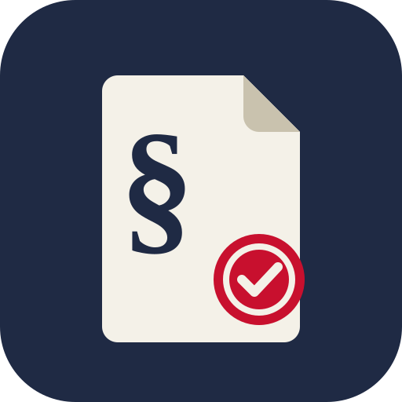

# US Regulatory Research

A Grok Bot / Cursor plugin for US federal regulatory research. It bundles a local MCP server and two skills. **No API keys needed.**



## What you get

**MCP tools** (server `us-regulatory`, local stdio, Node 18+):

| Tool | What it does |
| --- | --- |
| `ecfr_search` | Full-text search of the current Code of Federal Regulations, with optional title/part filters |
| `ecfr_get_section` | Current (or dated) text of one section, e.g. 47 CFR 15.109, tables included |
| `federal_register_search` | Rules, proposed rules and notices by term, agency, CFR title/part and date; returns effective and comment-close dates |
| `ibr_standards` | Standards incorporated by reference in a CFR part (from its eCFR IBR section, e.g. 47 CFR 15.38): publisher, number, edition, title, sections approved for; filter by section |
| `standards_link` | Official purchase/info links for IEC, ISO, UL, ANSI, ASTM, IEEE, NFPA, CIE, IES and NEMA standards |
| `fcc_grantee_lookup` | FCC equipment authorization grantee by FCC ID (grantee-code prefix), grantee code or company name |
| `regulatory_status` | Shows which sources are reachable |

**Skills**

- `fcc-part15-lookup`: answer FCC Part 15 questions from the current text, with citations
- `rule-change-watch`: open comment periods, upcoming effective dates and recent final rules for a CFR part or agency

For trademark and patent research, see the companion plugin [US Trademark & Patent Research](https://github.com/liminal-photonics/us-ip-plugin).

## Install

Install **US Regulatory Research** from the Grok Bot or Cursor plugin marketplace. To run it by hand in any MCP client:

```json
{
  "mcpServers": {
    "us-regulatory": {
      "command": "npx",
      "args": ["-y", "github:liminal-photonics/us-regulatory-plugin"]
    }
  }
}
```

## Examples

- "What are the FCC Part 15 radiated emission limits for a Class B device?"
- "Show me 47 CFR 15.19 labeling requirements."
- "Any FCC rules or proposed rules affecting 47 CFR Part 15 since July?"
- "Which standards are incorporated by reference in 47 CFR Part 15, and which edition applies to 15.31?"
- "Where can I buy ANSI C63.4-2014?"
- "Who is the grantee for FCC ID 2AC7Z-ESPWROOM32?"

## Data notes

- **eCFR** is an editorial compilation updated daily. It is not the official legal edition (that is the annual CFR on govinfo). Section text is capped at 20,000 characters.
- **Federal Register** results are newest first. Agency filters use slugs such as `federal-communications-commission`.
- **Standards are copyrighted.** `ibr_standards` and `standards_link` return citations and links only, never standard text. IBR material can be inspected for free at the issuing agency or NARA, as listed in each IBR section.
- **IBR parsing** reads the part's "Incorporation by reference" section, which isn't always numbered x.38 (it is found by heading). Parts that cite standards only inside individual sections return "none found". Entries are parsed from the published text, so check unusual designations against the section link.
- **Standards links:** UL (shopulstandards.com), ASTM, IEEE (numbers without dots) and NFPA get a product-page link. It is checked live and dropped if the page doesn't match. ASTM blocks automated checks, so its link comes back unverified. IEC, ISO, CIE, IES, NEMA and dotted IEEE numbers get the body's catalog search. Every result also includes an ANSI Webstore search. ISO's search page may need the number typed in again.
- **FCC grantees** come from the FCC Open Data portal dataset "EAS Equipment Authorization Grantee Registrations". The FCC last refreshed it on 2021-03-22, so newer grantees won't appear. It lists companies, not individual FCC ID grants. The FCC's own Equipment Authorization System (apps.fcc.gov/oetcf/eas) blocks automated access, so this plugin can't confirm a grant. Each result links there so you can check by hand. Contact names in the dataset are left out.
- Requests time out after 20 s (`US_REGULATORY_TIMEOUT_MS` changes this). A rate-limited source (HTTP 429) returns a clear message.
- Not legal advice. For equipment authorization questions, confirm with a test lab or TCB.
- IBR sections are found by heading ("Incorporation by reference", "Materials incorporated by reference", "Incorporations by reference", "Reference material") or by passing the section itself. Both the usual "IBR approved for §" wording and 49 CFR's ", into §§" wording are parsed, as are (i)/(ii) sub-items. Entries approved for an appendix rather than a numbered section keep that text in `approvedForText` with an empty `approvedFor` list.

## Development

```bash
npm install
npm test               # offline unit tests (fixtures trimmed from real API responses)
npm run live           # live smoke test over stdio
```

## License

MIT © Liminal Photonics
